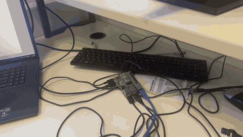
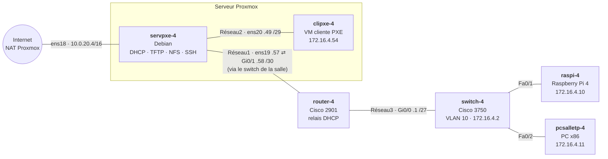
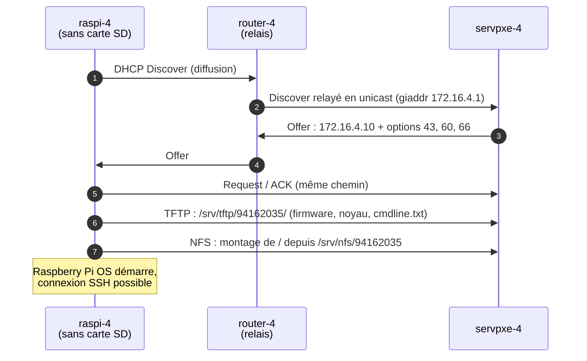
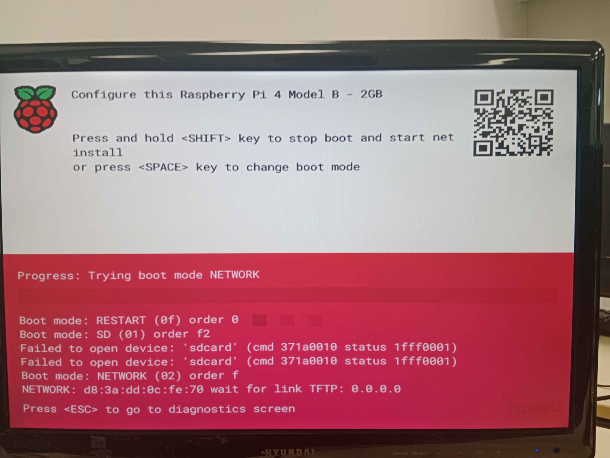
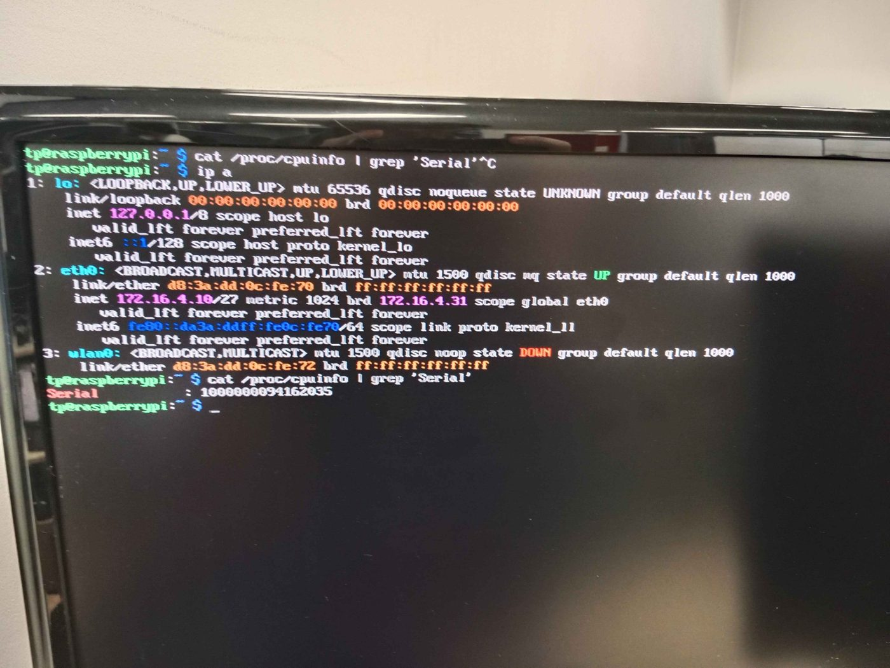
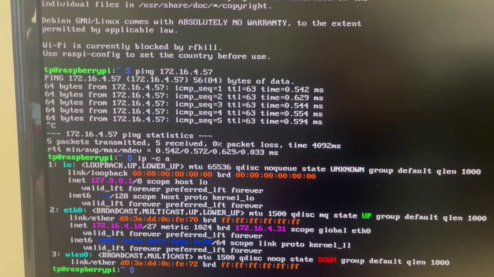
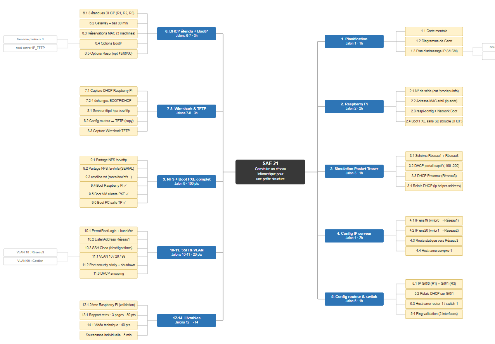
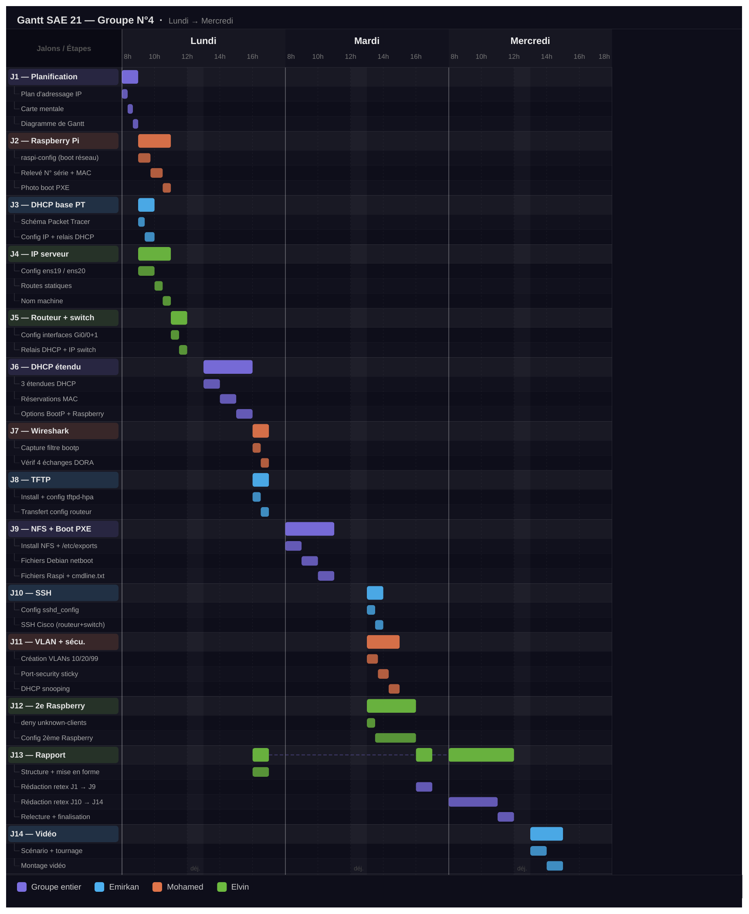

# Démarrage réseau (PXE) de PC, VM et Raspberry Pi — DHCP, TFTP, NFS et Cisco (SAÉ 21)

> Infrastructure qui permet à des machines **sans disque** de démarrer et de s'installer **par le réseau** :
> un PC x86, une machine virtuelle et un Raspberry Pi 4 (ARM), derrière un routeur et un switch Cisco.


**Contexte :** projet de 1ʳᵉ année de BUT Réseaux & Télécommunications (IUT Nord Franche-Comté, 2025-2026), réalisé en trinôme en trois jours dans le cadre de la SAÉ 21 *« Construire un réseau informatique pour une petite structure »*.
Une SAÉ est un projet en situation professionnelle, découpé en jalons validés par l'enseignant.


*Le Raspberry Pi, sans carte SD, cherche un serveur sur le réseau, charge son système par TFTP et NFS, puis joint le serveur à travers le routeur (vidéo accélérée — [version complète](docs/video/boot-pxe-raspberry.mp4)).*

*English summary at the [end of this page](#english-summary).*

---

## Sommaire

- [Ce qui a été construit](#ce-qui-a-été-construit)
- [Topologie](#topologie)
- [Plan d'adressage](#plan-dadressage)
- [Comment un Raspberry Pi démarre par le réseau](#comment-un-raspberry-pi-démarre-par-le-réseau)
- [Services du serveur](#services-du-serveur)
- [Équipements Cisco](#équipements-cisco)
- [Preuves de fonctionnement](#preuves-de-fonctionnement)
- [Laboratoire de test reproductible](#laboratoire-de-test-reproductible)
- [Relecture : ce qui a été corrigé](#relecture--ce-qui-a-été-corrigé)
- [Difficultés et retour d'expérience](#difficultés-et-retour-dexpérience)
- [Organisation](#organisation)
- [Structure du dépôt](#structure-du-dépôt)
- [English summary](#english-summary)

---

## Ce qui a été construit

- Un **plan d'adressage VLSM** : la plage 172.16.4.0/26 découpée en 4 sous-réseaux au plus juste.
- Un **serveur Debian** (VM Proxmox `servpxe-4`) qui fournit :
  - **DHCP** (isc-dhcp-server) : 3 étendues, réservations par adresse MAC, options PXE et options propres au Raspberry Pi, refus des machines inconnues ;
  - **TFTP** (tftpd-hpa) : fichiers de démarrage ;
  - **NFS** : système de fichiers racine des clients sans disque ;
  - **SSH** durci (pas de root, écoute sur un seul réseau, bannière).
- Un **routeur Cisco 2901** qui sépare les réseaux et **relaie le DHCP** vers le serveur (`ip helper-address`).
- Un **switch Cisco 3750** avec **VLAN**, **port-security** (adresse MAC apprise et verrouillée), **DHCP snooping** contre les serveurs DHCP pirates et ports inutilisés éteints.
- **Trois clients démarrant par PXE** : la VM `clipxe-4`, le PC de la salle `pcsalletp-4` (x86) et le Raspberry Pi 4 `raspi-4` (ARM), plus la procédure d'ajout d'un **deuxième Raspberry Pi**.

---

## Topologie



Réseau1 passe par le réseau de la salle, géré par un portail captif ; c'est la source de la principale panne du projet (voir [Difficultés](#difficultés-et-retour-dexpérience)).

---

## Plan d'adressage

Classe 172.16.**N**.0/26 avec N = numéro de groupe (4). On place d'abord le plus grand sous-réseau, et chaque masque est le plus petit qui contient les hôtes demandés :

| Réseau | Rôle | Hôtes demandés | Adresse | Masque | Plage utilisable | Broadcast |
|---|---|:---:|---|---|---|---|
| Réseau3 | Raspberry Pi, PC de la salle | 20 | 172.16.4.0 | /27 (255.255.255.224) | .1 → .30 (30) | .31 |
| Réseau4 | réservé (extension) | 10 | 172.16.4.32 | /28 (255.255.255.240) | .33 → .46 (14) | .47 |
| Réseau2 | VM clientes (vmbr1) | 5 | 172.16.4.48 | /29 (255.255.255.248) | .49 → .54 (6) | .55 |
| Réseau1 | lien serveur ↔ routeur (vmbr0) | 2 | 172.16.4.56 | /30 (255.255.255.252) | .57 → .58 (2) | .59 |

| Machine | Interface | Réseau | Adresse | Attribution |
|---|---|---|---|---|
| servpxe-4 | ens19 (vmbr0) | Réseau1 | 172.16.4.57 | statique (1ʳᵉ adresse) |
| servpxe-4 | ens20 (vmbr1) | Réseau2 | 172.16.4.49 | statique (1ʳᵉ adresse) |
| router-4 | Gi0/1 | Réseau1 | 172.16.4.58 | statique (dernière adresse) |
| router-4 | Gi0/0 | Réseau3 | 172.16.4.1 | statique (1ʳᵉ adresse) |
| switch-4 | VLAN 10 | Réseau3 | 172.16.4.2 | statique (2ᵉ adresse) |
| clipxe-4 | eth0 | Réseau2 | 172.16.4.54 | DHCP réservé (dernière adresse) |
| raspi-4 | eth0 | Réseau3 | 172.16.4.10 | DHCP réservé (10ᵉ adresse) |
| pcsalletp-4 | eth0 | Réseau3 | 172.16.4.11 | DHCP réservé (11ᵉ adresse) |

Le serveur atteint Réseau3 par une route statique : `up ip route add 172.16.4.0/27 via 172.16.4.58` ([`interfaces`](configs/serveur/interfaces)).

---

## Comment un Raspberry Pi démarre par le réseau



1. Le **relais DHCP** est indispensable : une diffusion ne traverse pas un routeur. Le routeur la retransmet au serveur en unicast et indique dans le champ `giaddr` de quel réseau vient la demande ; le serveur choisit l'étendue d'après ce champ.
2. Le serveur reconnaît le Pi à son **adresse MAC** et lui donne son adresse réservée, plus trois options que le chargeur de démarrage du Pi attend : **66** (adresse du serveur TFTP), **60** (`PXEClient`) et **43** (`Raspberry Pi Boot`).
3. Le Pi télécharge par **TFTP** les fichiers du dossier qui porte **son numéro de série** (`94162035`).
4. Le fichier [`cmdline.txt`](configs/raspberry/cmdline.txt) indique au noyau de monter sa racine en **NFS** : `root=/dev/nfs nfsroot=172.16.4.57:/srv/nfs/94162035`.

Les PC et la VM suivent le même principe avec PXE classique : `filename "pxelinux.0"` et `next-server` désignent le chargeur à télécharger, qui lance ensuite l'installateur Debian *netboot*.

---

## Services du serveur

| Service | Fichier | Points clés |
|---|---|---|
| Réseau | [`interfaces`](configs/serveur/interfaces) | ens18 en NAT (Internet), ens19 et ens20 statiques, route vers Réseau3 |
| DHCP | [`dhcpd.conf`](configs/serveur/dhcpd.conf), [`isc-dhcp-server`](configs/serveur/isc-dhcp-server) | 3 étendues, bail 30 min, 3 réservations, `allow bootp`, options PXE et Raspberry, `deny unknown-clients`, écoute sur ens19 et ens20 seulement, IPv4 seulement |
| TFTP | [`tftpd-hpa`](configs/serveur/tftpd-hpa) | racine `/srv/tftp`, option `--secure` (le client ne peut pas sortir de ce dossier) |
| NFS | [`exports`](configs/serveur/exports) | `/srv/tftp` en lecture seule, une racine en écriture par Raspberry Pi |
| SSH | [`sshd_config.extrait`](configs/serveur/sshd_config.extrait) | `PermitRootLogin no`, `ListenAddress 172.16.4.57`, bannière |

Extrait de [`dhcpd.conf`](configs/serveur/dhcpd.conf) :

```conf
# Réseau1 : rien à distribuer, mais la déclaration est obligatoire,
# sinon dhcpd ignore en silence les requêtes relayées qui arrivent sur ens19
subnet 172.16.4.56 netmask 255.255.255.252 { }

host raspi-4 {
    hardware ethernet d8:3a:dd:0c:fe:70;
    fixed-address 172.16.4.10;
    next-server 172.16.4.57;
    option tftp-server-name "172.16.4.57";                    # option 66
    option vendor-class-identifier "PXEClient";               # option 60
    option vendor-encapsulated-options "Raspberry Pi Boot";   # option 43
}

deny unknown-clients;   # aucune adresse pour une machine non déclarée
```

---

## Équipements Cisco

**Routeur** ([`router-4.txt`](configs/cisco/router-4.txt)) :

```
interface GigabitEthernet0/0
 ip address 172.16.4.1 255.255.255.224
 ip helper-address 172.16.4.57          ! relais DHCP vers servpxe-4
interface GigabitEthernet0/1
 ip address 172.16.4.58 255.255.255.252
```

**Switch** ([`switch-4.txt`](configs/cisco/switch-4.txt)) :

| Fonction | Configuration | Rôle |
|---|---|---|
| VLAN | Fa0/1-3 → VLAN 10 (Réseau3), Fa0/4-24 → VLAN 20 (Réseau4) | isoler les réseaux sur un même switch |
| Ports éteints | `shutdown` sur tous les ports inutilisés | pas de branchement sauvage |
| Port-security | `switchport port-security mac-address sticky` sur les ports du Pi et du PC | le port retient la première adresse MAC vue et se coupe si une autre machine est branchée |
| DHCP snooping | `ip dhcp snooping vlan 1-10`, `trust` uniquement sur Gi0/1 (vers le routeur) | un serveur DHCP pirate branché sur un port client est ignoré |
| Gestion | `interface Vlan10` → 172.16.4.2/27 | administration du switch depuis Réseau3 |

**SSH** sur les deux équipements : [`ssh-cisco.txt`](configs/cisco/ssh-cisco.txt) (nom de domaine, clé RSA 2048 bits, SSH v2, `transport input ssh`, compte local).

---

## Preuves de fonctionnement

|  |  |
|:---:|:---:|
| *Jalon 2 : sans carte SD, le Pi passe en mode NETWORK et attend une réponse DHCP/TFTP* | *Relevé du numéro de série (`94162035`) et de l'adresse MAC* |


*Le Pi démarré par le réseau a reçu 172.16.4.10/27 et joint le serveur 172.16.4.57 : TTL 63, soit un routeur traversé.*

**Capture Wireshark** ([`dhcp-relais-dora-pc.pcap`](captures/dhcp-relais-dora-pc.pcap), jalon 7) : les 4 échanges DHCP du PC de la salle, vus côté serveur. Les paquets viennent du routeur (172.16.4.1), pas du PC : c'est le relais.

| # | Source → destination | Message | Contenu |
|:---:|---|---|---|
| 1 | 172.16.4.1 → 172.16.4.57 | DHCP Discover | relayé, MAC client f0:b2:b9:23:30:d7 |
| 2 | 172.16.4.57 → 172.16.4.1 | DHCP Offer | 172.16.4.11, passerelle 172.16.4.1 |
| 3 | 172.16.4.1 → 172.16.4.57 | DHCP Request | |
| 4 | 172.16.4.57 → 172.16.4.1 | DHCP ACK | bail 600 s (voir [Relecture](#relecture--ce-qui-a-été-corrigé)) |

**Vidéo** : [démarrage complet du Raspberry Pi](docs/video/boot-pxe-raspberry.mp4) (1 min 36, son retiré).

**Simulation** : le relais DHCP a d'abord été modélisé dans Packet Tracer ([`simulation-dhcp-relais.pkt`](packet-tracer/simulation-dhcp-relais.pkt), jalon 3).

---

## Laboratoire de test reproductible

Sans le matériel de la salle, la topologie peut être recréée sur n'importe quel Linux avec des *network namespaces* : chaque équipement (serveur, routeur, clients) a sa propre pile réseau isolée, reliée aux autres par des câbles virtuels. Le serveur DHCP tourne avec le vrai [`dhcpd.conf`](configs/serveur/dhcpd.conf), le routeur relaie avec `dhcrelay` (l'équivalent Linux de `ip helper-address`), et un script envoie de vraies requêtes DHCP avec les adresses MAC de chaque machine.

```bash
sudo apt install isc-dhcp-server isc-dhcp-relay tftpd-hpa tftp-hpa iputils-ping
pip install scapy
sudo lab/lab.sh up                    # crée la topologie
sudo python3 lab/test_lab.py          # 7 tests
sudo lab/lab.sh down
```

Résultats, avec la configuration rendue pendant la SAÉ puis avec la version relue :

| Test | Rendu ([`dhcpd.conf.rendu`](configs/serveur/dhcpd.conf.rendu)) | Relu ([`dhcpd.conf`](configs/serveur/dhcpd.conf)) |
|---|---|---|
| VM clipxe-4 reçoit 172.16.4.54 | ⚠️ oui, mais bail de 600 s | ✅ bail de 1800 s |
| Raspberry reçoit 172.16.4.10 + options 43/60/66 (via le relais) | ⚠️ oui, mais bail de 600 s | ✅ |
| PC reçoit 172.16.4.11 et `pxelinux.0` (via le relais) | ❌ fichier `pxelinux-0` | ✅ |
| Machine inconnue dans Réseau3 refusée | ❌ reçoit 172.16.4.3 | ✅ aucune réponse |
| Machine inconnue dans Réseau2 refusée | ❌ reçoit 172.16.4.50 | ✅ aucune réponse |
| Ping raspi → serveur à travers le routeur | ✅ TTL 63 | ✅ TTL 63 |
| TFTP : le Pi télécharge son `cmdline.txt` | ✅ | ✅ |
| **Total** | **2/7** | **7/7** |

Pour rejouer la version rendue : `sudo lab/lab.sh up configs/serveur/dhcpd.conf.rendu`.

---

## Relecture : ce qui a été corrigé

En reprenant le projet pour le publier, j'ai relu les configurations et testé le DHCP dans le laboratoire ci-dessus. Les fichiers de [`configs/`](configs) sont la version corrigée ; la version rendue est conservée dans [`dhcpd.conf.rendu`](configs/serveur/dhcpd.conf.rendu).

| Écart dans la version rendue | Conséquence | Correction |
|---|---|---|
| `default-lease-time 600` | bail de 10 min au lieu des 30 demandées (visible dans la capture) | `1800` |
| `#deny unknown-clients;` (commenté) | n'importe quelle machine branchée reçoit une adresse | ligne réactivée |
| `filename "pxelinux-0"` pour le PC et le Pi | avec ce fichier, le PC demande un chargeur qui n'existe pas (le Pi n'utilise pas ce champ) | `pxelinux.0` |
| plage de Réseau2 jusqu'à .54 | l'adresse réservée à clipxe-4 était aussi dans la plage dynamique | plage .50 → .53 |
| switch sans `ip default-gateway` | il ne peut pas répondre au serveur, situé dans un autre réseau | ajouté dans [`ssh-cisco.txt`](configs/cisco/ssh-cisco.txt) |
| plan d'adressage du jalon 1 : interfaces du routeur inversées, plages de Réseau1 et 2 fausses | incohérence avec la configuration réelle | tableau refait d'après les configurations |

---

## Difficultés et retour d'expérience

- **Le portail captif bloquait le DHCP relayé.** Le PC envoyait ses Discover, le routeur les relayait (confirmé par le `debug` Cisco), mais rien n'arrivait sur le serveur, même avec `tcpdump` sur toutes les interfaces. Après avoir vérifié le relais, les droits, `iptables` et changé de routeur, la cause était le portail captif de la salle, qui filtrait l'UDP 67 entrant sur ens19. Il a fallu autoriser ce trafic.
- **dhcpd ignorait les requêtes sans rien dire.** isc-dhcp-server exige une déclaration `subnet` pour chaque interface sur laquelle il écoute, même s'il n'y distribue rien. Sans celle de Réseau1, les requêtes relayées étaient rejetées sans aucun message dans les journaux.
- **SSH entre OpenSSH et Cisco.** Les versions récentes d'OpenSSH refusent les anciens algorithmes du 2901 : ajout de `KexAlgorithms` et `Ciphers` côté client, et génération de la clé RSA dans le bon ordre (hostname → domain-name → `crypto key generate rsa` → `ip ssh version 2`).

Ce qui en reste : savoir diagnostiquer compte autant que connaître les commandes. Lire `syslog`, filtrer une capture, `tcpdump` sur la bonne interface, `debug` Cisco : chaque panne a été trouvée en suivant le paquet maillon par maillon. Retour d'expérience complet : [`docs/retour-experience.md`](docs/retour-experience.md).

---

## Organisation

Trois jours, 14 jalons. Un membre sur les équipements Cisco pendant que les deux autres avançaient sur les services Linux, en tenant compte des dépendances entre jalons.

|  |  |
|:---:|:---:|
| *Carte mentale : les 14 jalons et leurs étapes* | *Gantt : planning sur trois jours et répartition par membre* |

Procédure d'ajout du deuxième Raspberry Pi (jalon 12) : [`docs/deuxieme-raspberry.md`](docs/deuxieme-raspberry.md).

---

## Structure du dépôt

```
├── configs/
│   ├── serveur/           interfaces, dhcpd.conf (+ version rendue), isc-dhcp-server,
│   │                      tftpd-hpa, exports, sshd_config.extrait
│   ├── cisco/             router-4.txt, switch-4.txt, ssh-cisco.txt
│   └── raspberry/         cmdline.txt (Pi n°1 et n°2)
├── captures/              capture Wireshark DHCP (jalon 7)
├── packet-tracer/         simulation du relais DHCP (jalon 3)
├── lab/                   topologie en namespaces Linux + tests DHCP/TFTP
└── docs/
    ├── images/            photos, carte mentale, Gantt, animation du démarrage
    ├── video/             vidéo du démarrage du Raspberry Pi
    ├── retour-experience.md
    └── deuxieme-raspberry.md
```

Publiés sans : empreintes des mots de passe `enable`, numéro de série du routeur, sujets et grille de notation de l'IUT.

---

## English summary

**Network boot (PXE) infrastructure** built in three days by a team of three during the first year of a networking & telecommunications degree (BUT R&T, France).

- VLSM addressing plan (172.16.4.0/26 split into /27, /28, /29, /30).
- Debian server providing **DHCP** (isc-dhcp-server: three scopes, MAC reservations, PXE and Raspberry Pi options 43/60/66, unknown clients denied), **TFTP** and **NFS** root filesystems, plus hardened SSH.
- **Cisco 2901 router** relaying DHCP between subnets (`ip helper-address`) and **Cisco 3750 switch** with VLANs, port-security (sticky MAC), DHCP snooping and SSH.
- Three diskless clients booting over the network: a Proxmox VM, an x86 lab PC and a **Raspberry Pi 4 with no SD card** (TFTP folder named after its serial number, root filesystem over NFS).
- **Reproducible test lab**: the whole topology rebuilt with Linux network namespaces, a real `dhcrelay` and Scapy-driven DHCP exchanges. It caught four mistakes in the configuration handed in during the project (lease time, unknown clients served, a boot-file typo, a reserved address inside the dynamic range); the published configuration passes 7/7 tests.
- Main lesson: a captive portal silently dropping relayed DHCP traffic, found by following the packet hop by hop with `tcpdump`, Wireshark and Cisco `debug`.
